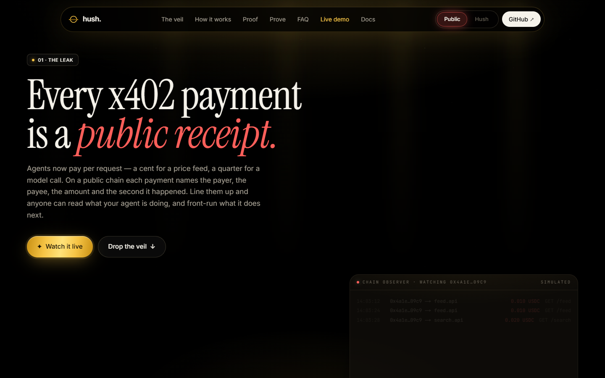
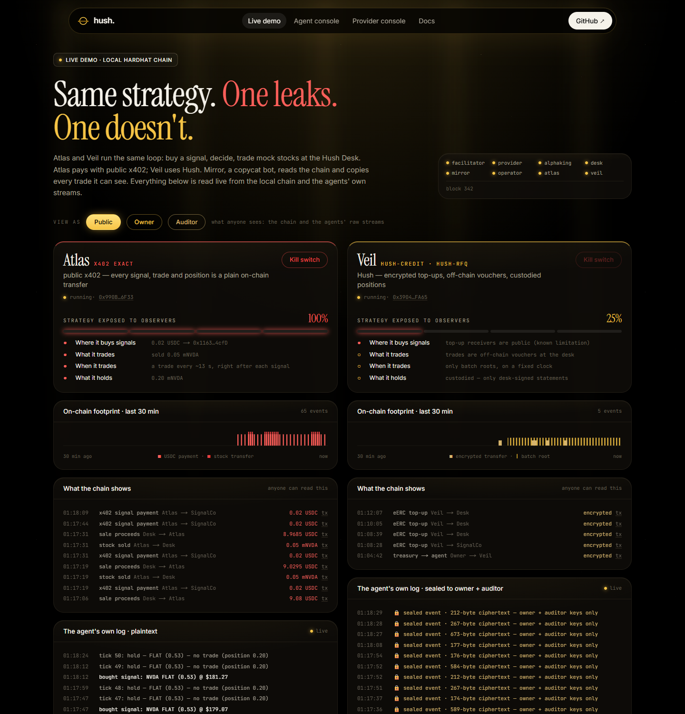
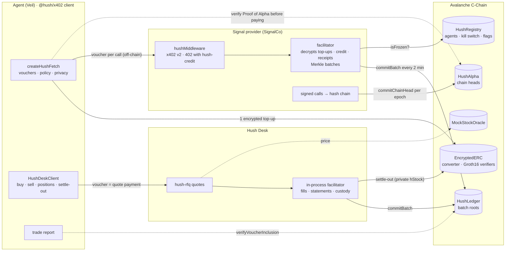
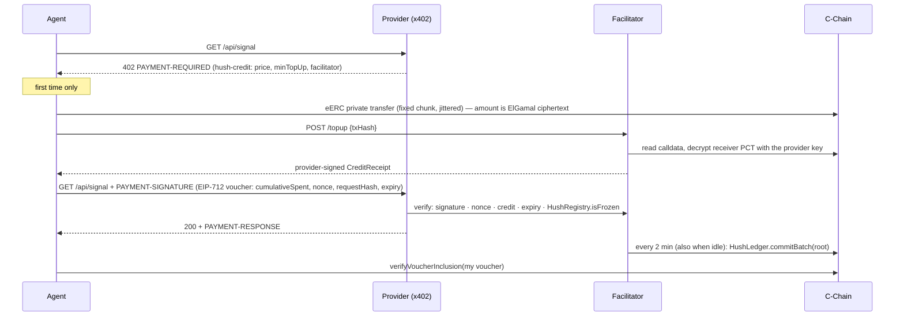

# hush.

**Private x402 payments for AI agents, on Avalanche.** Agents pay for APIs and trade without leaking their strategy:
payments are encrypted with **eERC** (Avalanche's encrypted ERC-20) on C-Chain, so only the agent's owner — and an
optional auditor — can see amounts. And when an agent (or the provider it pays) wants to prove its track record, it
can, to whoever it chooses, without publishing it.

> **Private by default. Provable on demand.**
> Built for the Avalanche Speedrun *Build Anything on Avalanche* cycle. Live on **Avalanche Fuji**.



---

## The problem

x402 lets an agent pay per request: an HTTP `402` names a price, the client pays, the server serves. On a public chain
every one of those payments is a receipt — payer, payee, amount, timestamp. Line them up and anyone can read what an
agent is doing: which data it buys, how often, when it trades and what it holds. **Mirror**, the copycat bot in our demo,
does exactly that: it reads public transfers and copies a public agent's trades a few seconds later.

## What Hush does

A strategy leaks through what an agent **learns**, what it **trades** and what it **holds**. Hush closes all three, then
lets it **prove** its record.

| | How | On-chain |
|---|---|---|
| **Learn** — paying for data | `hush-credit`: one encrypted eERC top-up to the provider, then a signed EIP-712 voucher per call | an occasional ciphertext + Merkle roots on a fixed clock |
| **Trade** — at the Hush Desk | `hush-rfq`: the 402 *is* a desk-signed quote; it is paid with a voucher whose `requestHash` is the quote's digest | nothing per trade |
| **Hold** — custody | the desk custodies positions and signs numbered statements; settle-out is one private eERC transfer | an encrypted transfer (asset visible, size hidden) |
| **Prove** — track records | providers commit a hash chain of signed calls to `HushAlpha` every epoch; agents hand out **trade reports** anchored in HushLedger | chain heads |

The demo runs two agents with the **same strategy** — buy a signal, decide, trade a mock stock — and lets Mirror watch:

| | Atlas (public x402 `exact`) | Veil (Hush) |
|---|---|---|
| Strategy exposed to observers | 100% — signal source, trades, timing, holdings | 25% — only the receivers of its top-ups (a known eERC limitation) |
| Mirror | copies every trade, a few seconds behind (2–4 s locally) | "nothing to copy — sees addresses and assets only" |



## Architecture



### hush-credit, one call



## Who sees what

| | Public | Owner | Auditor |
|---|---|---|---|
| Amounts and balances | ElGamal ciphertext | ✓ (the agent's eERC key) | ✓ (eERC auditor key) |
| Sender / receiver of a top-up | ✓ (known limitation) | ✓ | ✓ |
| Calls, trades, positions | Merkle roots only | ✓ sealed telemetry + the agent's ledger | ✓ sealed telemetry |
| How often the agent calls | no — roots land on a fixed cadence, empty or not | ✓ | ✓ |

Agent telemetry is sealed to the owner's and auditor's eERC keys (Poseidon-ECDH key wrap + AES-GCM). The operator
exports every eERC movement with auditor-decrypted amounts as CSV.

## Proof of Alpha and trade reports

- **Signal providers** sign every call (`SignalRecord`), file it under the epoch it was issued in, and commit
  `head_e = keccak(head_{e-1}, digest_e)` to `HushAlpha` during the next epoch — every epoch, with a heartbeat when empty.
  A proof reveals all records of a range; the verifier recomputes every head, checks signatures, filing and the oracle
  price at issue time, and grades each call only from its commit deadline (so nothing can be written with hindsight).
  **AlphaKing** hides its losing calls and claims ~90%: its proof fails at the first doctored epoch. Agents run
  `chooseProvider` before paying; the provider console runs it in the browser.
- **Agents** hand out a **trade report**: every desk-signed fill and position statement, each fill tied to the quote and
  the agent's voucher that paid for it (`requestHash = quote digest`), plus that voucher's Merkle proof in a HushLedger
  root. The desk numbers statements 1, 2, 3, … so a hidden losing trade shows; P&L is replayed with the desk's own
  average-cost arithmetic and marked at the oracle. `verifyTradeReport` is viem-only and runs in a browser. It trusts the
  desk (the counterparty that signs every record).
- **Verifiers pin their trust anchors.** A proof or report names its own contracts; `verifyProof` / `checkProvider`
  take `{ hushAlpha, chainId }` and `verifyTradeReport` takes `expect: { desk, hushLedger, hushAlpha, chainId }`, so a
  provider can't point at a HushAlpha of its own and an agent can't sign as a "desk" it controls.

## Contracts

**Avalanche Fuji (chain 43113)** — [`packages/contracts/deployments/fuji.json`](packages/contracts/deployments/fuji.json)

| Contract | Address | Role |
|---|---|---|
| EncryptedERC | [`0x9Aa48Af8…2F2396`](https://testnet.snowtrace.io/address/0x9Aa48Af8C613e8fEA7Ef8c8BB859A0a8C52F2396) | Ava Labs eERC, converter mode, prod verifiers |
| Registrar | [`0x9F674A79…00B34b`](https://testnet.snowtrace.io/address/0x9F674A79fcEc3B472A35895ab6a4FA870200B34b) | eERC BabyJubJub keys |
| MockUSDC | [`0x77a5b649…2DeCF7`](https://testnet.snowtrace.io/address/0x77a5b64985b910652826183213d12bf3dc2DeCF7) | EIP-3009 test USDC |
| HushRegistry | [`0x8CdEaaF1…221ef6`](https://testnet.snowtrace.io/address/0x8CdEaaF16304a6E03002b90a6029b8E79e221ef6) | providers, agents (EIP-712 consent), kill switch, flags |
| HushLedger | [`0x1D6ee5d0…387577`](https://testnet.snowtrace.io/address/0x1D6ee5d0AA41f191A361C4306EbCc9E2Aa387577) | voucher batch roots, receipt/voucher verification |
| HushAlpha | [`0xA45c0B7F…779079`](https://testnet.snowtrace.io/address/0xA45c0B7F393692DC7ad6c2dA287EA8415a779079) | EIP-712 domain for quotes/fills/statements/signals; chain heads (600 s epochs) |
| MockStockOracle | [`0x61B554EE…655236`](https://testnet.snowtrace.io/address/0x61B554EE20BbAe5456c795a106BAdEAEdf655236) | mock stock prices, `getPriceAt` |
| mNVDA · mTSLA · mSPY | [`0xd4F3…70F2`](https://testnet.snowtrace.io/address/0xd4F3f123C3432FB85B8e57f1ABBAef54829470F2) · [`0xa4F1…0156`](https://testnet.snowtrace.io/address/0xa4F143Ab50BF1663Be8a3B500DfA4EfD179b0156) · [`0x2cB2…1538`](https://testnet.snowtrace.io/address/0x2cB23Ab31589240d81b8a56b361D8dA0cE5C1538) | mock stocks (no issuer integration is claimed) |

**Avalanche C-Chain mainnet** — the accountability layer (`HushRegistry`, `HushLedger`, optionally `HushAlpha`; no eERC,
no mocks) deploys with `pnpm deploy:mainnet` (dry run unless `CONFIRM_MAINNET=yes`; a separate
`MAINNET_DEPLOYER_PRIVATE_KEY`). Addresses land in `packages/contracts/deployments/avalanche.json`.

## Quickstart

Node ≥ 22, pnpm 11. Everything runs on a local hardhat chain; drop `:local` to target Fuji.

```sh
pnpm install
pnpm keys                                           # role keys → .env (testnet only; never reuse on mainnet)
pnpm node                                           # terminal 1: hardhat
pnpm fund:local && pnpm deploy:local && pnpm bootstrap:local
pnpm demo:local                                     # price bot, facilitator, providers, desk, operator, Mirror, Atlas, Veil
pnpm web                                            # → http://localhost:3000  (/demo · /console/agent · /console/provider · /docs)
```

### Checks

| Command | What it proves | Result |
|---|---|---|
| `pnpm test` | contracts (Hardhat) + SDK (vitest) | 43 + 71 passing |
| `pnpm e2e:local` | hush-credit end to end: 402, private top-up, vouchers, receipts, batch inclusion, policy, kill switch, flagging, refund, hush-direct, privacy options | 15/15 |
| `pnpm desk-e2e:local` | hush-rfq: signed quotes, private buys, replay/expiry refusal, signed positions, trade policy, sells, settle-outs, the agent's audit of the desk | 15/15 |
| `pnpm mirror-e2e:local` | Mirror copies Atlas's public trades and has nothing to copy from Veil | 6/6 |
| `pnpm alpha-e2e:local` | Proof of Alpha: SignalCo verifies, AlphaKing fails, tampered proofs fail, provider choice | 9/9 |
| `pnpm journey:local` | a brand-new agent's whole private journey → a complete, on-chain-anchored trade report; cherry-picking caught; zero public token transfers | 12/12 |
| `pnpm mcp:smoke:local` | drives the MCP server like a host does (13 tools) | ✓ |

The local results above are from 2026-10-18. On Fuji, earlier versions of the suites passed `pnpm e2e` 13/13 (P3) and
`pnpm desk-e2e` 14/14 (V2).

## Use it

**Agents** — `@hush/x402` (npm-ready: `pnpm --filter @hush/x402 build`):

```ts
import { createHushFetch, HushDeskClient } from "@hush/x402/client";

const hush = createHushFetch({
  mode: "hush-credit", wallet, eercClient, publicClient,
  policy: { dailyCap: 5_000_000n },                       // API spend, enforced before signing
  tradePolicy: { maxNotionalPerTrade: 25_000_000n },      // trading guard rails
  privacy: { topUpChunks: [5_000_000n], jitterMs: [10_000, 45_000] },
});
await hush.fetch("https://provider.example/api/signal?ticker=NVDA");

const desk = new HushDeskClient({ deskUrl, hush, signer: wallet });
await desk.buy("NVDA", "0.10");
await desk.settleOut("NVDA", "0.05");
```

**Providers** — one middleware, all three schemes over x402 v2:

```ts
import { hushMiddleware } from "@hush/x402/server";
app.use(hushMiddleware({ payTo, contracts, facilitatorUrl, routes: { "GET /api/feed": { price: "$0.01" } } }));
```

**Anyone, in a browser** — `checkProvider`, `verifyProof`, `verifyTradeReport` from `@hush/x402/contracts` (viem only).

**Any LLM agent** — `@hush/mcp`, an MCP stdio server (run from this repo; it reads the repo's `.env` and deployments):
`hush_pay`, `hush_balance`, `hush_history`, `hush_verify`, `hush_refund`, `hush_freeze`/`hush_unfreeze`, `hush_quote`,
`hush_trade`, `hush_positions`, `hush_settle`, `hush_verify_provider`, `hush_prove_me`.

```sh
claude mcp add hush -- node packages/mcp/bin/hush-mcp.mjs     # Claude Desktop config: packages/mcp/README.md
```

## Why Avalanche

- **eERC on C-Chain** — encrypted balances and transfers whose Groth16 proofs the chain verifies itself. No FHE
  coprocessor, no second network, no bridge: the privacy lives where the money is.
- **Converter mode** wraps any ERC-20, so the same contract carries hUSDC and the desk's hStock (tokenIds per asset).
- **Contract-level auditor key** gives the compliance view (public / owner / auditor) out of the box.
- **Fast finality and low fees on C-Chain** make fixed-cadence batch commits (every 2 minutes, empty or not) and
  per-epoch Proof of Alpha heads cheap enough to run continuously — which is what hides activity timing.

## Related work

- **x402 `batch-settlement`** (x402 foundation): escrow-backed payment channels, cumulative vouchers, batched claims —
  trustless for the client, but deposits, amounts and claims are public. **hush-credit is the private counterpart.** The
  trade-off: the provider is trusted for prepaid credit (bounded by signed receipts, on-chain Merkle commitments, private
  refunds, 7-day expiry and public flags). There is no private escrow because an eERC balance can only be spent by its
  BabyJubJub key holder through a ZK proof — a contract cannot hold and release one without changes to eERC.
- **x402z** (Mind Network + Zama; FHE, ERC-7984) and **Fhenix** (FHE) — need an FHE coprocessor network.
- **PrivateX402** (Nethermind) — payment channels.
- **Hush differs:** Avalanche-native with client-side zk-SNARKs + ElGamal verified on C-Chain; compliance built in
  (public / owner / auditor views); hides call frequency and per-call patterns; provider accountability (receipts, roots,
  flags, Proof of Alpha); private trading and custody; a drop-in x402 v2 mechanism; an MCP server for any LLM agent.

## Known limitations

- eERC hides amounts and balances, **not addresses**: the sender and receiver of a top-up are public. Mitigations: few
  top-ups, fixed chunk sizes, timing jitter. A relayer or pooled payer is future work.
- Credit mode **trusts the provider** for prepaid balances; custody **trusts the desk** for positions (bounded by
  signed statements the agent audits, and custody never exceeds the desk's encrypted inventory).
- **Proof generation takes seconds**, which is why per-call payments are vouchers and only top-ups are proven.
- eERC converter **deposits are public** and use fixed randomness (a balance becomes confidential once a private
  transfer is received). eERC registration is one-time: no key rotation; the wallet is the key backup.
- The stocks and the oracle are **mocks on Fuji**; no issuer (Dinari, Pharaoh, …) integration is claimed.
- One signer per agent key at a time: two processes trading with the same key keep separate ledgers, so each one's
  trade report shows the other's statements as gaps.
- The Claude agent brain (`AGENT_BRAIN=claude`) is implemented, but the demo runs the deterministic rules brain.

## Repository

```
packages/contracts   Hardhat: eERC (vendored, Ava Labs Ecosystem License) · MockUSDC · HushRegistry · HushLedger ·
                     HushAlpha · MockStock / MockStockOracle · deploy, verify, status, mainnet scripts
packages/sdk         @hush/x402 — x402 v2 schemes (hush-credit, hush-direct, hush-rfq), client/server/facilitator,
                     eERC account, sealed telemetry, Proof of Alpha, trade reports
packages/mcp         @hush/mcp — MCP stdio server (13 tools)
packages/config      shared network, deployments, role keys
apps/facilitator     Express + SQLite: top-ups, credit, receipts, vouchers, refunds, Merkle batches, SSE
apps/provider-demo   SignalCo (/api/feed, /api/signal, /proof-of-alpha) + AlphaKing (:4025)
apps/desk            Hush Desk: quotes, custody, sells, settle-outs (in-process facilitator)
apps/agent           Atlas + Veil (rules or Claude brain), treasury, reveal
apps/mirror          the copycat bot
apps/price-bot       mock stock prices → MockStockOracle
apps/operator        owner/auditor/provider-admin API behind the consoles (loopback only); auditor CSV
apps/scripts         bootstrap, demo launcher, e2e suites, journey
apps/web             Next.js 16 + R3F: landing, /demo, /console/agent, /console/provider, /docs
docs/                v2 plan and decisions, demo script, screenshots
```

## Built during the event vs. pre-existing

**Pre-existing, used as dependencies:** the eERC contracts and circuits (`ava-labs/EncryptedERC@8dc98cd`, vendored
under the Ava Labs Ecosystem License — see `LICENSE-eERC.md`), `@avalabs/eerc-sdk`, the x402 v2 packages
(`@x402/core|evm|express|fetch`), the MCP TypeScript SDK, OpenZeppelin contracts and Merkle tree, viem, Hardhat,
Next.js, React Three Fiber.

**Built during the event (28 Sep – Oct 2026):** everything else — the Hush contracts (HushRegistry, HushLedger,
HushAlpha, mocks), the `hush-credit` / `hush-rfq` / `hush-direct` schemes and SDK, the facilitator, the desk, sealed
telemetry, Proof of Alpha, trade reports, the agents, Mirror, the price bot, the operator, the MCP server, the e2e
suites and the web app.

## AI tools used

- **Claude Code** (Anthropic) was used throughout as a pair programmer: research, design, implementation, tests and
  this documentation, with every phase reviewed, run and verified by the author.
- **Claude** (`claude-sonnet-5`) is the optional decision-making brain of the demo agents and the model behind any
  MCP host using `@hush/mcp`.

## License

Hush code: MIT. eERC contracts and circuits: © Ava Labs, Ecosystem License (Avalanche-only).
